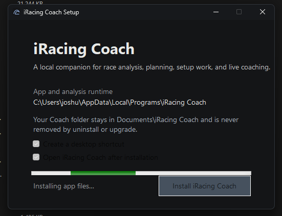

# 0.17.0 Testing Feedback

Reported by Joshua on September 20, 2026, while testing development round 1. These items are open follow-up work; the delivered 0.17.0 package has not been changed.

## Installer

### INSTALL-FB-001: Unreadable text after clicking Install

**Reported defect.** After clicking Install, the checkbox labels and Install button text turn black against the dark installer surface. The supplied screenshot captures the defect during file installation.

Required change: retain readable text and a clear disabled state while installation is running. Verify the initial, installing, success, and failure/retry states in the packaged Windows installer.

Investigation starting point: `InstallerForm.InstallClicked` disables the button and both checkboxes. Inspect native disabled-control painting; setting the normal foreground color alone may not control the disabled state. This is a suspected mechanism, not a completed fix.

### INSTALL-FB-002: Automatically remove previous installed versions

**Explicit requirement for future releases.** Installing a new release must remove or replace previous installed iRacing Coach versions, including obsolete program files, shortcuts, and uninstall entries, so older installed versions are not left behind. This reinforces existing requirements `UPG-001` through `UPG-004`.

Preserve the Coach data home, settings, reports, analysis/tuning history, and original iRacing files. Keep upgrade rollback possible until the replacement succeeds. Cleanup must target verified application installations, not unrelated folders or arbitrary portable copies.

Investigation starting point: `InstallerEngine.RemoveLegacyInstallations` already checks several known locations, but silently catches access and I/O failures. Verify actual upgrade behavior and report unresolved cleanup clearly instead of treating the existence of this method as proof that removal works. The user requested this behavior; the supplied screenshot does not establish which older installations remain on the machine.

Acceptance: install over supported prior versions and legacy installation locations; verify that only the current installed version remains, old registrations and shortcuts are removed, durable data is preserved, and failed upgrades recover without losing the last usable installation.
